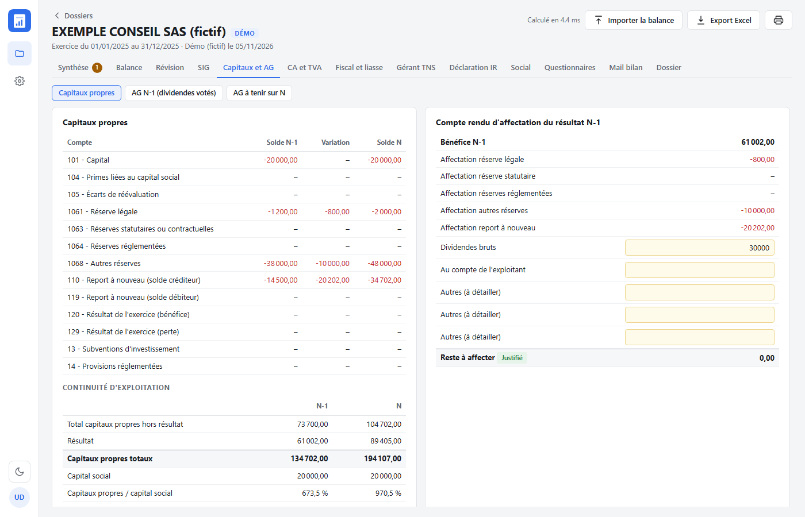

# Dossier Bilan

Preparing a year-end closing file means going through the trial balance cycle by cycle, tying revenue to VAT, computing corporate tax, preparing the AGM, and checking that everything adds up.
In a lot of small firms, that work lives in spreadsheets copied from one client to the next, with controls that are easy to miss.

I built a web app for it: one file per client and per year, everything recalculated instantly, and controls that block the file when something doesn't add up.

**What problem it solves:** year-end files prepared consistently, with automatic checks that catch errors before the file goes to the chartered accountant.

## The accounting behind it

**Review by cycle.** Every account of the trial balance is assigned to a cycle (cash, receivables and payables, tax, payroll, fixed assets, equity, loans…) and gets a review status and a comment, carried over to the next year.

**Controls that block the file**, shown on the summary page:
- trial balance N and N-1 balanced to the cent
- result from the SIG (French management balances) = accounting result
- last year's profit allocation fully justified, account by account (1061, 1068, 110/119, dividends…)
- revenue tied to VAT: from revenue per rate, through accruals, receivables and cash collected, to the taxable base actually declared on the CA3 returns
- equity below half of the share capital flagged

**Tax and legal**
- taxable income with add-backs and deductions (non-deductible fines and gifts, parent-subsidiary regime with its 5% share of costs…)
- tax losses carried forward, capped at €1M + 50% of the profit above (art. 209 I CGI)
- corporate tax at 15% up to €42,500, then 25%
- profit allocation at the AGM: legal reserve (5% of profit until it reaches 10% of capital), dividends per partner, social charges, 12.8% withholding, IFU boxes
- for a majority manager (TNS): the part of dividends above 10% of capital, share premium and current account is subject to social contributions, plus the year-end provision for contributions based on the PASS

**And the rest of the closing:** SIG with % of revenue and year-on-year variations, loans split by maturity for the notes, payroll journal tied to the accounts by social body, a recap of the owner's income tax boxes, and a draft email to the client with key figures and upcoming deadlines.

| SIG | Equity and allocation |
|---|---|
|  |  |

## How I make sure it's right

The calculation engine is covered by automated tests, written from the accounting rules:
- each rule on its own (tax loss cap, legal reserve, dividend split, VAT tie-out…)
- 30 randomly generated client files, checked against invariants that must always hold (balanced trial balance, SIG = accounting result, equity after the AGM…)
- broken or messy imports (duplicate accounts, odd formats) handled without silently dropping lines

## Tech stack

- Python 3.10+ and Flask
- HTML, CSS and JavaScript front end
- pytest for the calculation engine
- Pennylane API (read-only) or Excel / CSV import, Excel export
- GitHub Actions for the tests

## How to run

You need Python 3.10+. No account, no internet.

- Windows: double-click `demo.bat`
- macOS / Linux: `sh demo.sh`

Then open http://localhost:8095 (login `demo` / `demo`). The demo has three fake companies: a consulting firm, a bakery and a loss-making digital studio.

Tests: `python -m pytest tests`

The whole file is recalculated on every input in under 10 ms. The trial balance comes from Pennylane (read-only API) or from an Excel / CSV file, and the whole file can be exported to Excel.

## What's not done yet

- I followed Pennylane's public docs for the API but haven't tried it with a real token yet.
- It's built for a small team, so there are no per-file permissions.

The interface is in French, since it was made for a French firm.

<!-- Screenshot placeholder: add more captures in docs/ and reference them here -->

All data in this repository is synthetic. No client data is included.

MIT licence. Made by Mehdi Mobtahij.
