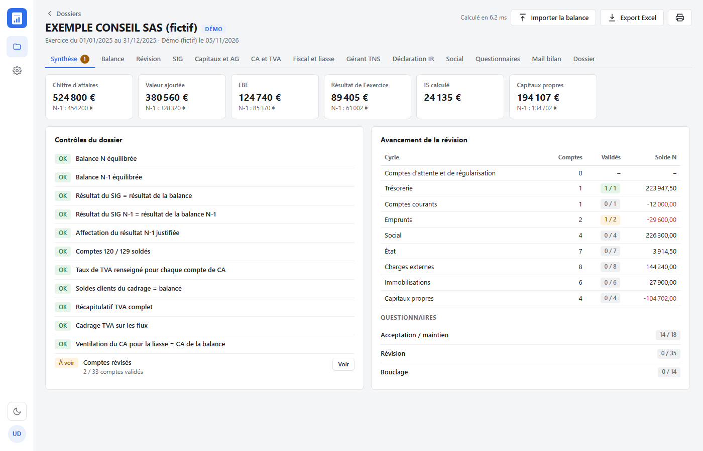
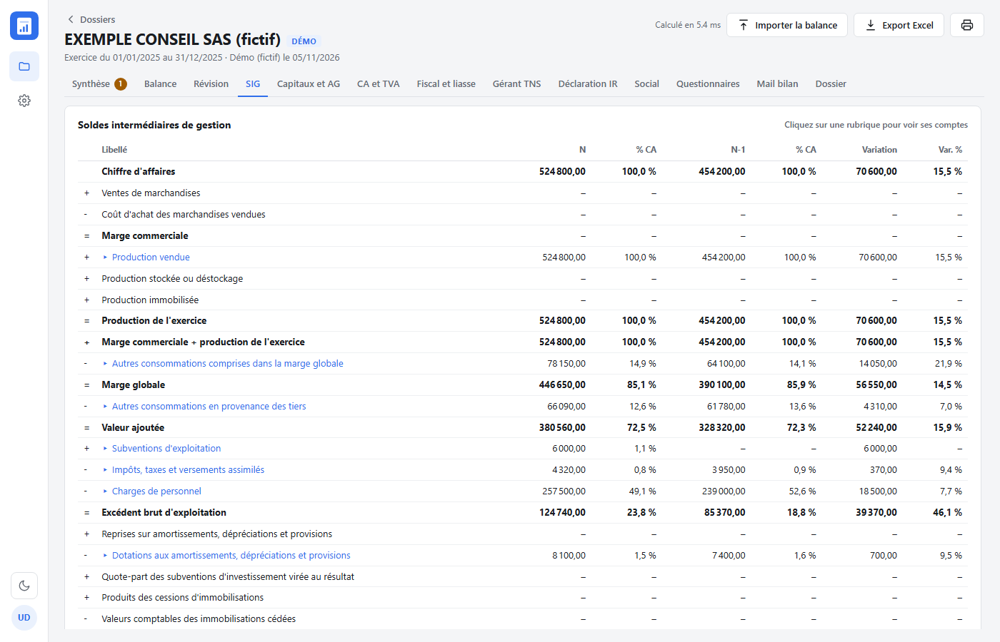

# Dossier Bilan

Application web de **dossier de travail de clôture** pour un cabinet d'expertise comptable : de la balance importée jusqu'au mail de bilan envoyé au client, en passant par la révision par cycle, les SIG, l'affectation du résultat, le cadrage du CA et de la TVA, l'IS et l'aide à la liasse.



## Le problème métier

Dans beaucoup de cabinets, le dossier de clôture d'un client est un **gros classeur Excel à macros** copié d'un exercice à l'autre. Celui dont part ce projet comptait 42 feuilles et environ 20 000 formules. Il marchait, mais :

- il fallait coller la balance à la main, et chaque copie du modèle embarquait des données d'anciens clients ;
- plusieurs formules étaient fausses sans que rien ne le signale (déficit reportable perdu, quote-part comptée deux fois, contrôles toujours « ok ») ;
- au-delà de certaines tailles (26 comptes de CA, 144 comptes par cycle…), il ignorait des lignes sans prévenir ;
- un seul utilisateur à la fois, et aucune trace de qui avait modifié quoi.

**Dossier Bilan reprend ce classeur formule par formule** dans une application web : même logique métier, mais un calcul instantané, des contrôles fiables, plusieurs utilisateurs et un historique.

## Ce que fait l'application

Un dossier par client et par exercice. Les cellules ambrées sont des saisies ; tout le reste est calculé, et le dossier entier est recalculé à chaque saisie (moins de 10 ms).

| Onglet | Contenu |
|---|---|
| **Synthèse** | Chiffres clés et contrôles bloquants : balances équilibrées, résultat du SIG = résultat comptable, affectation N-1 justifiée, TVA cadrée, avancement de la révision. |
| **Balance** | Balance comparative N / N-1, variations, commentaires par compte. |
| **Révision** | Révision par cycle (trésorerie, tiers, État, social, immobilisations, capitaux…) : statut et commentaire par compte, repris d'un exercice à l'autre. |
| **SIG** | Soldes intermédiaires de gestion avec % du CA, N-1, variations et détail des comptes. |
| **Capitaux et AG** | Capitaux propres, affectation du résultat N-1, AG à tenir : réserve légale, dividendes par associé (prélèvements sociaux, précompte, part soumise à cotisations des TNS). |
| **CA et TVA** | Cadrage du chiffre d'affaires par taux, récapitulatif des déclarations CA3, cadrage de la TVA sur le solde et sur les flux. |
| **Fiscal et liasse** | Résultat fiscal (réintégrations, déductions, déficit imputable plafonné), IS au taux réduit et normal, emprunts, aide à la liasse. |
| **Gérant TNS** | Provision des cotisations, DRITI, PAMC, écritures de provision. |
| **Déclaration IR** | Récapitulatif des cases de la 2042 et IFU par associé. |
| **Social** | Rapprochement du journal de paie avec la comptabilité, par organisme. |
| **Questionnaires** | Acceptation / maintien de la mission, révision, bouclage. |
| **Mail bilan** | Chiffres clés, échéances (IS, TVA, flat tax) et projet de mail au client. |

Autres fonctions : import de la balance depuis **Pennylane** (API, lecture seule) ou depuis un fichier Excel / CSV / tableau collé ; import des déclarations de TVA déposées via un **connecteur de poste** qui lit les PDF ; reprise des statuts, associés et réglages de l'exercice précédent ; **export Excel** du dossier calculé ; impression de chaque onglet ; historique des modifications ; détection des modifications concurrentes (verrou optimiste : rien n'est écrasé sans le savoir).

| SIG | Capitaux propres et affectation |
|---|---|
|  |  |

## Essayer en 30 secondes

Prérequis : Python 3.10 ou plus récent. Aucun compte externe, aucune connexion réseau.

- **Windows** : double-cliquez sur `demo.bat`.
- **macOS / Linux** : `sh demo.sh`.

Puis ouvrez **http://localhost:8095**. La connexion est automatique (compte `demo`, mot de passe `demo`).

À la main :

```bash
python -m venv .venv
.venv/bin/pip install -r requirements.txt        # Windows : .venv\Scripts\pip ...
BILAN_DEMO=1 .venv/bin/python serveur/lancer.py  # Windows : set BILAN_DEMO=1 puis .venv\Scripts\python serveur\lancer.py
```

Le mode démo crée **trois dossiers fictifs** (un cabinet de conseil, une boulangerie, un studio numérique en perte), avec des balances N et N-1 cohérentes, des associés, des déclarations de TVA, une paie et un gérant TNS. Tous les noms et montants sont inventés. Les données de la démo vivent dans `data-demo/` : supprimez ce dossier pour repartir de zéro. En démo, Pennylane et le connecteur sont désactivés côté serveur.

## Fiabilité : comment c'est prouvé

| Vérification | Ce qu'elle prouve |
|---|---|
| **Banc de parité avec l'Excel d'origine** (`tests/parite/`) | Des dossiers fictifs complets (balance de 100 à 350 comptes et saisies dans toutes les feuilles) sont écrits dans une **copie** du classeur, recalculés par Excel (piloté par COM), relus et comparés au moteur au centime près. Dernière campagne : **35 526 cellules sur 13 dossiers, 0 écart imprévu**. Les seuls écarts sont les défauts de l'Excel corrigés, chacun identifié par le banc. |
| **9 défauts de l'Excel détectés et corrigés** | Documentés un par un dans [docs/ECARTS_EXCEL.md](docs/ECARTS_EXCEL.md), avec la cellule fautive, l'effet et la correction. Exemple : l'imputation du déficit antérieur n'était pas plafonnée au bénéfice, ce qui faisait disparaître du déficit reportable (art. 209 I du CGI). |
| **Tests automatiques** (`python -m pytest tests`) | Règles comptables, chaque correction de l'Excel, imports de fichiers, robustesse face aux saisies abîmées, invariants sur 30 dossiers aléatoires, connecteur de bout en bout, cohérence des dossiers de démo. |

Le banc de parité se lance sur un poste Windows avec Excel :

```bash
pip install -r requirements-dev.txt
python tests/parite/excel_parite.py "chemin/vers/le/classeur.xlsm" 1 2 3
```

**Le classeur Excel d'origine n'est pas publié** (document interne d'un cabinet) : le banc est fourni pour montrer la méthode, il ne peut pas être rejoué sans lui. Les tests `pytest`, eux, tournent partout.

## Stack et architecture

- **Python 3 / Flask** pour l'API JSON, **waitress** comme serveur, **SQLite** pour le stockage (versions et journal), **openpyxl** pour les imports et l'export Excel, **requests** pour Pennylane.
- **JavaScript sans framework ni dépendance** pour l'interface (une page, routage par ancre), thème clair et sombre.
- **PyMuPDF** côté connecteur pour lire les PDF de déclarations de TVA.

Le point central : **le moteur de calcul est pur**. Il ne lit ni n'écrit aucun fichier et n'appelle aucun réseau : un dossier (infos, balance, saisies) entre, tous les résultats et contrôles sortent. Il est donc testable, comparable à l'Excel, et l'API se contente de le rappeler à chaque saisie.

```
serveur/
  moteur/          calcul pur, un module par domaine
    balance.py  sig.py  capitaux.py  ca_tva.py  fiscal.py  tns.py  ir.py  social.py  synthese.py  questionnaires.py
    referentiel.py   tables reprises de l'Excel (rubriques du SIG, cycles, PASS, lignes de la CA3)
    dossier.py       enchaîne les feuilles dans l'ordre de leurs dépendances et produit les contrôles
  app.py           API Flask (sessions, en-têtes de sécurité, verrou optimiste)
  stockage.py      SQLite : dossiers, versions, journal
  pennylane.py     lecture des balances par l'API Pennylane (cabinet ou entreprise)
  comptazap.py     réception des déclarations envoyées par le connecteur
  import_fichier.py  export_excel.py  comptes.py  demo.py  lancer.py
web/               index.html, app.js, styles.css, logo.svg
connecteur/        programme du poste : lit les PDF de TVA, contrôle, envoie au site
tests/             tests pytest et banc de parité (tests/parite/)
docs/              REGLES.md (règles de calcul en clair), ECARTS_EXCEL.md (écarts avec l'Excel)
```

Documentation métier :
- [docs/REGLES.md](docs/REGLES.md) : toutes les règles de calcul en clair, feuille par feuille ;
- [docs/ECARTS_EXCEL.md](docs/ECARTS_EXCEL.md) : les 9 corrections, les limites de taille de l'Excel et 6 points de doctrine à faire valider par l'expert-comptable.

## Intégrations (hors démo)

- **Pennylane** : un jeton d'API (cabinet ou entreprise) se saisit dans Paramètres et reste sur le serveur ; l'application ne fait que lire. Les adresses appelées sont regroupées dans `CHEMINS` en tête de `serveur/pennylane.py`.
- **Connecteur de poste** : un logiciel de bureau tiers télécharge les déclarations de TVA déposées sur impots.gouv. Le connecteur (`connecteur/`), installé sur ce poste, lit les PDF des CA3 / CA12, vérifie que le montant lu sur le PDF égale celui enregistré par le logiciel, puis envoie le détail des cases au site. Il s'identifie par un code de liaison dont seule l'empreinte est gardée.

Configuration par variables d'environnement : `BILAN_PORT` (8095), `BILAN_HOTE`, `BILAN_DATA` (dossier des données), `BILAN_HTTPS=1` (cookies `Secure` derrière un proxy HTTPS), `BILAN_COMPTES` (« id:Nom,id2:Nom2 », comptes créés au premier lancement avec un mot de passe provisoire), `BILAN_SANS_MDP=1` (réseau local de confiance), `BILAN_DEMO=1`, `PENNYLANE_TOKEN`, `PENNYLANE_BASE`. Un `Dockerfile` est fourni.

## Limites assumées

- **Les adresses de l'API Pennylane n'ont pas encore été essayées avec un vrai jeton.** Elles suivent la documentation publique ; le bouton « Tester la connexion » affiche la réponse brute pour corriger `CHEMINS` au premier essai.
- La balance Pennylane d'un exercice suppose que les à-nouveaux de l'exercice précédent sont passés.
- L'API Pennylane ne donne pas le détail des déclarations de TVA : il vient du connecteur, ou d'un export Excel en secours.
- Le banc de parité dépend du classeur d'origine, non publié, et d'Excel sous Windows.
- Six points de doctrine restent à trancher par un expert-comptable (voir `docs/ECARTS_EXCEL.md`) ; en attendant, l'application fait comme l'Excel.
- Outil interne conçu pour une petite équipe : pas de gestion fine des droits par dossier.

## Auteur

Mehdi Mobtahij. Licence MIT (voir [LICENSE](LICENSE)).
